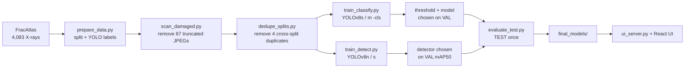
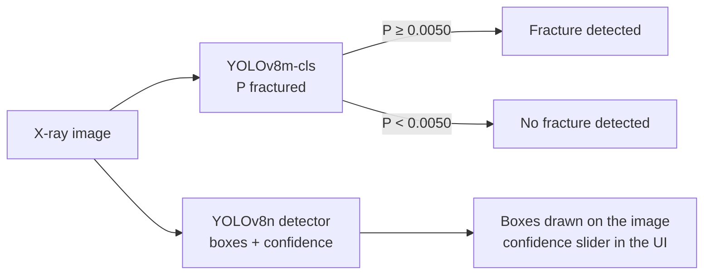
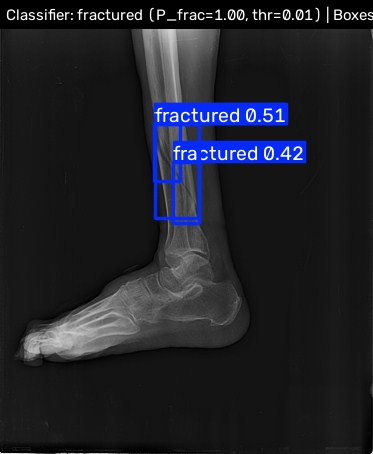
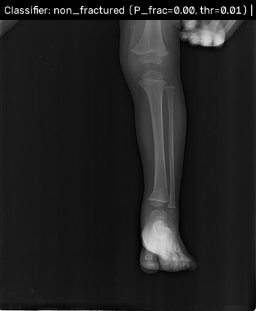
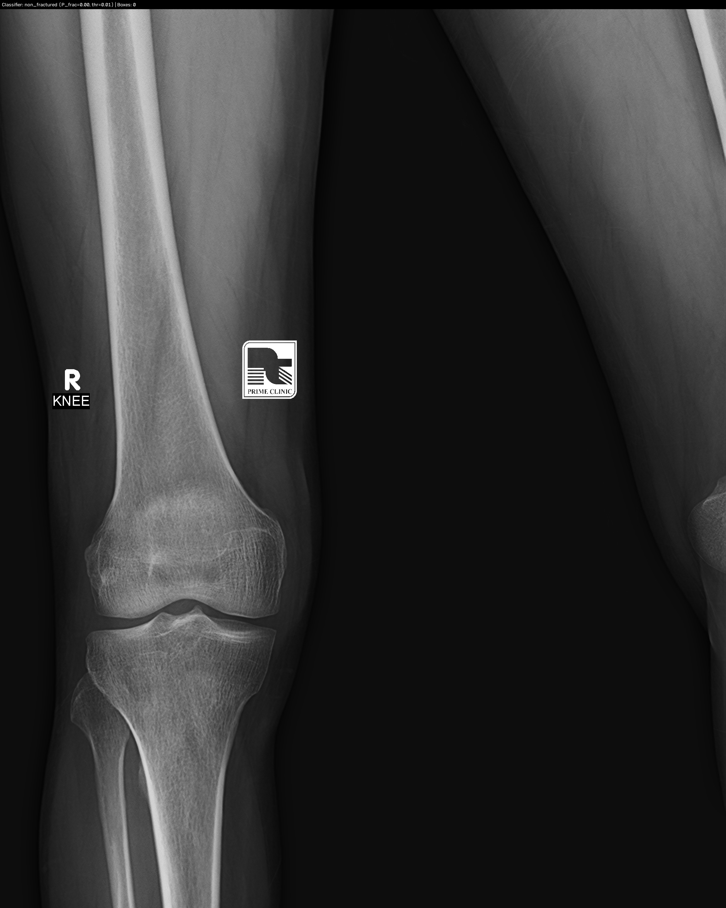
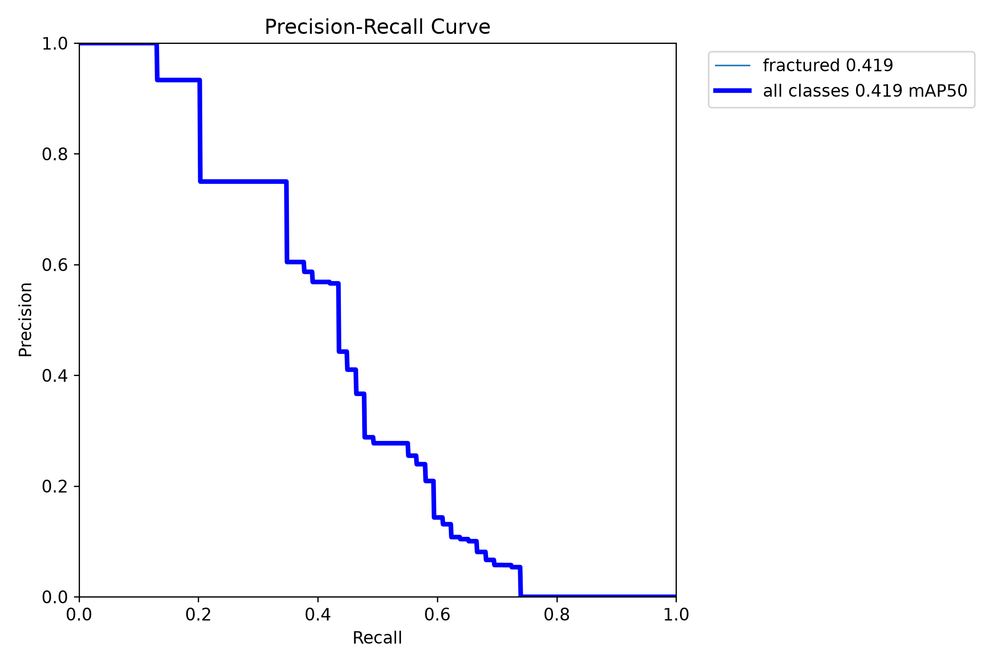

<div align="center">

# 🦴 Bone Fracture Detection

### Fracture classification and localization in musculoskeletal X-rays with YOLOv8, plus a React web app


-8A2BE2)


**Test accuracy 87.2% · fracture recall 84.1% · detection mAP50 0.419**
<br>on a cleaned, leakage-free held-out test set that was evaluated once

</div>

---

## 📑 Table of contents

1. [Project overview](#-1-project-overview)
2. [Key results](#-2-key-results)
3. [How it works](#-3-how-it-works)
4. [Dataset](#-4-dataset)
5. [Setup](#-5-setup)
6. [How to run the pipeline](#-6-how-to-run-the-pipeline)
7. [Results notebook](#-7-results-notebook)
8. [Web app (React + FastAPI)](#-8-web-app-react--fastapi)
9. [Models](#-9-models)
10. [Detailed results](#-10-detailed-results)
11. [Model selection on validation](#-11-model-selection-on-validation)
12. [Improvement attempts](#-12-improvement-attempts)
13. [Error analysis](#-13-error-analysis)
14. [Comparison with published results](#-14-comparison-with-published-results)
15. [Limitations](#%EF%B8%8F-15-limitations)
16. [Project structure](#-16-project-structure)
17. [Credits and license](#-17-credits-and-license)

---

## 🔍 1. Project overview

This project trains two YOLOv8 models on the **FracAtlas** musculoskeletal X-ray dataset
([DOI 10.6084/m9.figshare.22363012](https://doi.org/10.6084/m9.figshare.22363012)):

| Task | Question | Output | Final model |
|---|---|---|---|
| **Classification** | Is this X-ray *fractured* or *non_fractured*? | One label per image + probability | YOLOv8m-cls (512 px) |
| **Localization** | Where is the fracture? | Bounding boxes with confidence | YOLOv8n detector (640 px) |

The two models are trained and evaluated separately and combined in a **web app** where you upload an X-ray
and get a verdict, a fracture score and boxes drawn on the image.

**Evaluation rules followed throughout:**

- ✅ Train images are used only for learning the model weights.
- ✅ Every choice (epoch, model, decision threshold, detector) is made on the **validation** set.
- ✅ The **test** set is never used for training or tuning; it is evaluated once per final candidate.
- ✅ Damaged images and duplicate images across splits are removed, so test images can't leak into training.

---

## 🏆 2. Key results

<table>
<tr>
<td width="50%" valign="top">

**Classification** (test set, 345 images)

| Metric | Value |
|---|---|
| Accuracy | **87.2%** |
| Fracture recall | **84.1%** (53 of 63) |
| Precision | **60.9%** |
| F1 (fractured) | **0.707** |

</td>
<td width="50%" valign="top">

**Localization** (test set, 69 fracture boxes)

| Metric | Value |
|---|---|
| mAP50 | **0.419** |
| mAP50-95 | 0.169 |
| Precision | 0.560 |
| Recall | 0.405 |

</td>
</tr>
</table>

**Test confusion matrix (classifier):**

| true \ predicted | fractured | non_fractured |
|---|---|---|
| **fractured** | ✅ 53 | ❌ 10 |
| **non_fractured** | ⚠️ 34 | ✅ 248 |

> Only about 18% of images are fractured, so a model that always answers "normal" would already score
> about 82% accuracy. Read accuracy together with fracture recall, precision and F1.

---

## ⚙️ 3. How it works



**At prediction time** both models run on the same image:



The decision threshold **0.0050** looks very low, but it is deliberate: the classifier is very confident on
most images, and this threshold was chosen on the validation set so that the model finds about 80% of
fractures (see [section 11](#-11-model-selection-on-validation)).

---

## 📊 4. Dataset

**FracAtlas** has 4,083 X-ray images from hand, leg, hip and shoulder regions. 719 of them are fractured
(`fracture_count > 0` in `dataset.csv`), and there are 924 fracture boxes in total.

| | Fractured | Non-fractured | Total |
|---|---|---|---|
| Original images | 719 | 3,364 | 4,083 |
| Train / val / test before cleaning | 574 / 82 / 63 | 2,686 / 384 / 294 | 3,260 / 466 / 357 |
| **Train / val / test after cleaning** | <!-- COUNTS_FR -->574 / 82 / 63<!-- /COUNTS_FR --> | <!-- COUNTS_NF -->2,617 / 374 / 282<!-- /COUNTS_NF --> | <!-- COUNTS_ALL -->3,191 / 456 / 345<!-- /COUNTS_ALL --> |

### Splits

- Fractured images keep the official FracAtlas split (`Utilities/Fracture Split/{train,valid,test}.csv`).
- Non-fractured images are split randomly (seed 42) in the same ratio, about 80 / 11 / 9%.

### Three views of the same split

The same images and the same split are stored in three formats, one per use:

| Folder | Format | Used for |
|---|---|---|
| `datasets/cls` | `fractured/` and `non_fractured/` folders | Classifier val and test evaluation |
| `datasets/cls_os` | Same, but the **train fractured images are copied 3×** (574 → 1,722). Val is not copied; there is no test folder. | Classifier training (balances the classes) |
| `datasets/det` | Images + YOLO box labels + `data.yaml` (1 class: `fractured`) | Detector training and evaluation. Boxes: 764 train, 91 val, 69 test |

### Annotation formats

FracAtlas ships YOLO, COCO JSON, PASCAL VOC and VGG JSON annotations. This project uses
`Annotations/YOLO/` (class 0 = fracture). Non-fractured images get an empty label file.
`Annotations/YOLO/labels.txt` is a class-name file, not a label, so it is ignored.

### Data cleaning

- **Damaged images:** some JPEGs are truncated in the original zip (24 of them cut off at exactly
  16,384 bytes). `scan_damaged.py` finds them and removes them from every split; they are listed in
  `damaged_images.txt`. <!-- DAMAGED -->In total 87 damaged images were removed (all non-fractured): train 69, val 8, test 10.<!-- /DAMAGED -->
- **Cross-split duplicates:** 4 byte-identical images appear in two splits under different names.
  `dedupe_splits.py` removes the copy in the later split (train < val < test); they are listed in
  `duplicates_removed.txt`:
  - `IMG0000006.jpg` removed from val (duplicate of train `IMG0002294.jpg`)
  - `IMG0000001.jpg` removed from val (duplicate of train `IMG0002295.jpg`)
  - `IMG0004341.jpg` removed from test (duplicate of train `IMG0004314.jpg`)
  - `IMG0000002.jpg` removed from test (duplicate of val `IMG0002296.jpg`)
- **Fractured images also in `Non_fractured/`:** 2 fractured images (IMG0003375, IMG0003376) also have a
  byte-identical copy in `images/Non_fractured/`. `dataset.csv` is the source of truth, so they are used only as
  fractured; their copies are not used anywhere.
- **IMG0003298** was checked: fractured (`fracture_count = 1`, official test split, 1 YOLO box), already
  labelled correctly.
- **Original files:** the FracAtlas files were checked against `FracAtlas.zip` (all 4,083 images identical)
  and are never modified. The datasets are built from copies.

---

## 🛠️ 5. Setup

**Tested on:** Windows 11 · Python 3.13.17 · NVIDIA GeForce RTX 3050 Laptop GPU (4 GB VRAM) · CUDA 12.6
build of PyTorch · Node.js 24 (for the web app).

```powershell
git clone https://github.com/bikash880/Bone_Fracture_Detection.git
cd Bone_Fracture_Detection

python -m venv .venv
.\.venv\Scripts\Activate.ps1
pip install torch==2.14.1 torchvision==0.29.1 --index-url https://download.pytorch.org/whl/cu126
pip install -r requirements.txt
python -c "import torch; print(torch.cuda.is_available())"   # should print True
```

<details>
<summary><b>Linux / macOS</b></summary>

```bash
python3 -m venv .venv && source .venv/bin/activate
pip install torch==2.14.1 torchvision==0.29.1 --index-url https://download.pytorch.org/whl/cu126   # NVIDIA GPU
pip install -r requirements.txt
```
Without an NVIDIA GPU, install the CPU build of PyTorch. The web app falls back to CPU automatically; the
training scripts use `device=0` and need a GPU.
</details>

**The dataset is not included in this repository.** You only need it to retrain or re-evaluate; the web app
works without it, using the trained weights in `final_models/`. To get it:
1. Download FracAtlas from [figshare](https://doi.org/10.6084/m9.figshare.22363012).
2. Unzip it so that `FracAtlas/` (with `images/`, `Annotations/`, `Utilities/`, `dataset.csv`) is in the
   project folder.

**Windows notes:**
- With **Smart App Control** turned on, Windows can block PyTorch's DLLs (`WinError 4551`). Turning it off
  fixes this. Windows only lets you turn it back on by resetting or reinstalling Windows.
- If Windows Application Control blocks the `jupyter-nbconvert.exe` launcher, run
  `python -m nbconvert ...` instead.
- On battery power a laptop GPU can be throttled (about 20 W instead of about 70 W), roughly doubling epoch
  time. Train with the charger plugged in.

---

## ▶️ 6. How to run the pipeline

### One command (resumable)

```powershell
python run_all.py            # run or resume: skips steps already done (pipeline_state.json)
python run_all.py --status   # show which step is running and the training progress
python run_all.py --stop     # stop safely: training stops after the current epoch's checkpoint
```

How resuming works:
- Finished steps are recorded in `pipeline_state.json` and skipped on restart.
- An unfinished training run continues from `runs/<task>/<name>/weights/last.pt`
  (`YOLO(last.pt).train(resume=True)`).
- On CUDA out-of-memory, the batch size is halved, saved in the state file, and the run resumes.
- Ctrl+C also works (at most the current epoch is lost).

### Step by step

Run from the project folder, in order, with the venv active:

| # | Command | What it does |
|---|---|---|
| 1 | `python prepare_data.py` | Builds `datasets/det` (YOLO detection + `data.yaml`) and `datasets/cls` (fractured / non_fractured folders) |
| 2 | `python scan_damaged.py` | Finds damaged JPEGs, removes them from all splits, writes `damaged_images.txt` |
| 3 | `python dedupe_splits.py` | Removes byte-identical duplicates found in more than one split |
| 4 | `python train_classify.py --model yolov8s-cls.pt` | Trains the classifier (fractured images oversampled 3x in train only) and tunes the threshold on val for fractured recall ≥ 0.85 |
| 4b | `python train_classify.py --model yolov8m-cls.pt --batch 8 --skip-build` | Larger classifier, because tuned val accuracy was < 90% |
| 4c | `python ensemble.py <s_run> <m_run>` | Averages s + m predictions and tunes the threshold on val |
| 4d | `python recall_table.py <runs...>` | Val accuracy at 85 / 80 / 75% recall; you then choose (here: m at 80% recall) |
| 4e | `python set_threshold.py fracatlas_yolov8m_cls_512 0.80` | Re-tunes the chosen classifier's threshold on the saved val probabilities |
| 5 | `python train_detect.py --name detect_clean` | Trains YOLOv8n localization on the cleaned data |
| 5b | `python train_detect.py --model yolov8s.pt --name detect_clean_s --batch 8 --patience 20` | Trains YOLOv8s localization, for an n vs s comparison |
| 6 | `python select_detect.py fracatlas_yolov8n detect_clean detect_clean_s` | Chooses the detector by val mAP50 |
| 7 | `python evaluate_test.py --det-run <chosen> --cls-run <chosen>` | **One-time** test evaluation (incl. box recall at confidence 0.25 and 0.10); writes `results.md`, fills `final_models/` |
| 8 | `python analyze.py` | Per-region and error analysis; adds the Analysis section to `results.md`, saves `errors/` |
| 9 | `python predict.py <image.jpg> [...]` | Runs both final models on images; saves annotated output to `outputs/` |
| 10 | `python fill_readme.py` | Fills the numbers in this README from the saved results |

If a training run fails with CUDA out-of-memory, halve `--batch` and run it again.

---

## 📓 7. Results notebook

**[`FracAtlas_results.ipynb`](FracAtlas_results.ipynb)** presents the whole project in Jupyter cells
**without retraining**. The exact training code is included behind a `TRAIN = False` switch, and all results are
loaded from the saved files:

| Section | Content |
|---|---|
| 1 | Dataset counts per split, oversampled counts, box counts |
| 2–3 | Classifier training code; loss and val-accuracy curves (94 epochs, best epoch 74) |
| 4 | Threshold chosen on val, with a val accuracy / recall trade-off plot |
| 5 | Train / val / test table and three confusion matrices |
| 6–8 | Detector training code, loss and mAP curves, test metrics, PR curve |
| 9 | Example predictions on 3 test images |
| 10 | Summary table |
| 11 | The documented improvement attempt (see [section 12](#-12-improvement-attempts)) |

Open it in VS Code or Jupyter and select the `.venv` kernel (`pip install ipykernel` once).

---

## 🌐 8. Web app (React + FastAPI)

An interactive web app to try the final models on any X-ray.

```powershell
# once: build the React app (needs Node.js)
cd ui
npm install
npm run build
cd ..

# every time: start the server, then open http://127.0.0.1:8000
python ui_server.py
```

### Features

- 📤 **Drag-and-drop upload** (JPG, PNG, BMP, TIFF, WebP; up to 25 MB), or pick one of 6 sample test images
  tagged with their true label.
- 🩻 **Image viewer** with animated fracture boxes and a scanning animation while the models run.
- 🎚️ **Box confidence slider** (5–90%, default 25%) and a show/hide switch for the boxes. The server returns
  all boxes ≥ 5%, so the slider filters instantly without re-uploading.
- 🟥🟩 **Verdict card:** "Fracture detected" or "No fracture detected", the fracture score on a log-scale bar
  with the threshold marked, per-box confidences, and processing time (about 70 ms on GPU).
- ⚠️ **Disagreement hints** when the classifier and the detector disagree (for example "fracture" but no box).
- 📈 **Model performance panel** with the saved test metrics and the confusion matrix.
- 📱 Responsive dark-theme layout, with a clear "not a medical diagnosis" disclaimer.

### Architecture

| Part | File | Role |
|---|---|---|
| Backend | [`ui_server.py`](ui_server.py) | FastAPI. Loads `final_models/` once (GPU if available, otherwise CPU), serves the API and the built React app |
| Frontend | [`ui/src/App.jsx`](ui/src/App.jsx), [`ui/src/styles.css`](ui/src/styles.css) | React 18 + Vite single-page app |

| Endpoint | Method | Returns |
|---|---|---|
| `/api/info` | GET | Model names, threshold, device, saved test metrics |
| `/api/predict` | POST (multipart `file`) | `fractured`, `probability`, `threshold`, `boxes` [{x1, y1, x2, y2, conf}], `width`, `height`, `ms` |
| `/api/examples` | GET | Sample test images with their true labels |
| `/api/examples/{name}` | GET | The image file |

For UI development, run `npm run dev` inside `ui/` (port 5173; `/api` is forwarded to port 8000).

### How to test the app

Use images from the **test** split (`datasets/cls/test/...`). The model never saw them. Don't use train or
val images: they will look almost perfect and give a false impression.

| Expected outcome | Folder | Example images |
|---|---|---|
| ✅ Fracture found | `fractured` | IMG0003339 (leg), IMG0003374 (hand), IMG0003565 (hand) |
| ❌ Fracture missed (known error) | `fractured` | IMG0003297 (leg), IMG0003310 (hand), IMG0003311 (hand) |
| ⚠️ False alarm (known error) | `non_fractured` | IMG0000718 (leg + hip), IMG0002730 (leg), IMG0001769 (hand) |
| ✅ Correctly normal | `non_fractured` | IMG0000013 (leg), IMG0000028 (leg), IMG0000031 (hand) |

**X-rays from outside FracAtlas** can be uploaded as JPG or PNG (DICOM `.dcm` files must be exported to
JPG or PNG first). Expect less reliable results: the model only learned from FracAtlas hand, leg, hip and
shoulder X-rays. The detector is the weaker model, so "fractured" without a box is common; lower the slider
to 10% or 5% to see weaker box candidates. Everything runs locally; images are not saved or sent anywhere.

### Example outputs (`predict.py`)

| Fractured, found | Fractured, missed by the classifier | Normal |
|---|---|---|
|  |  |  |

---

## 🧠 9. Models

| Task | Model | Key settings |
|---|---|---|
| Classification | <!-- CLS_MODEL -->YOLOv8m-cls (ImageNet-pretrained), run `fracatlas_yolov8m_cls_512`<!-- /CLS_MODEL --> | <!-- CLS_SETTINGS -->imgsz 512, batch 8, up to 100 epochs (patience 20; ran 94, best epoch 74), seed 42; fractured train images oversampled 3x; threshold 0.0050 tuned on val for fractured recall >= 0.80<!-- /CLS_SETTINGS --> |
| Localization | <!-- DET_MODEL -->YOLOv8n<!-- /DET_MODEL --> (COCO-pretrained), run <!-- DET_RUN -->`fracatlas_yolov8n`<!-- /DET_RUN --> | <!-- DET_SETTINGS -->imgsz 640, batch 16, up to 100 epochs (patience 25; ran 100, best epoch 94), seed 42; chosen by val mAP50 among all detection runs<!-- /DET_SETTINGS --> |

Training details shared by both: default Ultralytics augmentation (classifier: RandAugment, horizontal flip,
random erasing 0.4, HSV jitter, scale 0.5), SGD (`optimizer: auto`), lr0 0.01, AMP mixed precision.

**Final files** (`final_models/`):

| File | Content |
|---|---|
| `classify_fracatlas_yolov8m_cls_512_best.pt` | Classifier weights (30 MB) |
| `classifier_threshold.json` | Decision threshold 0.005017 (chosen on val) |
| `detect_best.pt` | Detector weights (6 MB) |
| `detector_info.json` | Detector source run and image size |

---

## 📈 10. Detailed results

<!-- RESULTS -->
**Classification** (fractured = positive class, threshold 0.0050 chosen on val)

| | Train | Val | Test |
|---|---|---|---|
| Accuracy | 96.0% | 85.7% | **87.2%** |
| Fractured recall | 100.0% | 80.5% | **84.1%** |
| Fractured precision | 81.7% | 57.4% | **60.9%** |
| Fractured F1 | 0.899 | 0.670 | **0.707** |

Test confusion matrix: 53 fractures found, 10 missed, 34 false alarms, 248 normal images correctly cleared.

**Localization** (test set, run `fracatlas_yolov8n`)

| mAP50 | mAP50-95 | Precision | Recall |
|---|---|---|---|
| **0.419** | 0.169 | 0.560 | 0.405 |

| Confidence | Boxes found (IoU >= 0.5) | Box recall | Wrong boxes | Normal images with a false box |
|---|---|---|---|---|
| 0.25 | 26 / 69 | 37.7% | 15 | 6 / 282 |
| 0.10 | 30 / 69 | 43.5% | 34 | 14 / 282 |

Val numbers are slightly optimistic because the model and threshold were chosen on val; the test numbers are the honest estimate. Full report: `results.md`.
<!-- /RESULTS -->

> **Why train > test > val?** Train is highest because the model learned from those images. Val is slightly
> optimistic in principle (the model and threshold were chosen on it); test is the honest result, used once
> after every choice was fixed. Test being a little above val here is within the noise of small sets.

### Test set size: 63 vs 61 fractured images

The test set has 2 fractured images, **IMG0003375** and **IMG0003376**, beyond the 61 reported in the
FracAtlas paper. The released `test.csv` lists 63, and the released files have 719 fractured images and 924
boxes against the paper's 717 and 922; these 2 images (1 box each) account for exactly that difference. They
are also the only fractured images with a byte-identical copy in `images/Non_fractured/`. This project follows
the released split files, so both are fractured test images. Neither appears in train or val (checked by file
name and MD5). The 63-image results above are the main result.

**For reference, without these 2 images:** accuracy 87.2%, fractured recall 83.6% (51 / 61), precision 60.0%,
F1 0.699; box recall at confidence 0.25: 25 / 67 = 37.3%.

Full report with every table: **[`results.md`](results.md)**.

---

## 🎯 11. Model selection on validation

### Detector: by val mAP50 (cleaned val set)

| Run | Val mAP50 | Val mAP50-95 | Val precision | Val recall |
|---|---|---|---|---|
| **fracatlas_yolov8n (chosen)** | **0.492** | 0.202 | 0.652 | 0.462 |
| detect_clean (YOLOv8n, retrained on cleaned data) | 0.452 | 0.216 | 0.672 | 0.396 |
| detect_clean_s (YOLOv8s, cleaned data) | 0.410 | 0.175 | 0.580 | 0.424 |

Bigger or retrained was not better: the original YOLOv8n had the highest val mAP50, so only it was evaluated
on test.

### Classifier: a deliberate recall / accuracy trade-off

Candidates (YOLOv8s-cls, YOLOv8m-cls, and their averaged ensemble) were first tuned for 85% val recall; none
reached 90% val accuracy (best: m, 79.8%). So each candidate's val accuracy was computed at thresholds giving
85%, 80% and 75% fractured recall (val only):

| Run | Target recall | Threshold | Val accuracy | Val recall | Val precision | Val F1 | FN | FP |
|---|---|---|---|---|---|---|---|---|
| YOLOv8s-cls | 0.85 | 0.0041 | 0.719 | 0.854 | 0.376 | 0.522 | 12 | 116 |
| YOLOv8s-cls | 0.80 | 0.0065 | 0.750 | 0.805 | 0.402 | 0.537 | 16 | 98 |
| YOLOv8s-cls | 0.75 | 0.0136 | 0.776 | 0.756 | 0.431 | 0.549 | 20 | 82 |
| YOLOv8m-cls | 0.85 | 0.0018 | 0.798 | 0.854 | 0.467 | 0.603 | 12 | 80 |
| **YOLOv8m-cls (chosen)** | **0.80** | **0.0050** | **0.857** | **0.805** | **0.574** | **0.670** | **16** | **49** |
| YOLOv8m-cls | 0.75 | 0.0364 | 0.897 | 0.756 | 0.697 | 0.725 | 20 | 27 |
| s + m ensemble | 0.85 | 0.0042 | 0.741 | 0.854 | 0.398 | 0.543 | 12 | 106 |
| s + m ensemble | 0.80 | 0.0088 | 0.776 | 0.805 | 0.434 | 0.564 | 16 | 86 |
| s + m ensemble | 0.75 | 0.0572 | 0.862 | 0.756 | 0.590 | 0.663 | 20 | 43 |

**Chosen: YOLOv8m-cls at 80% recall (threshold 0.0050).** Compared with 85% recall it gives up about 5 points
of recall (4 more missed val fractures) for about 6 points of accuracy and 31 fewer false alarms. The 75%
option is closer to 90% accuracy but would miss 1 in 4 fractures. With the default 0.5 cut-off the same model
reaches 93.2% val accuracy but only 67.1% recall, which is unacceptable for a screening aid.

---

## 🧪 12. Improvement attempts

Two further attempts to raise test accuracy were made after the final model was fixed. Both used the same
rules (choose on val, test once) and **neither beat the final model on test**, so it stayed final. Their files
were removed; the results are recorded here and in the notebook.

### Attempt 1: YOLOv8m-cls at 640 px, 150 epochs, patience 30

Threshold chosen on val as "≥ 90% val accuracy with the highest recall" (0.3515). Training stopped early at
epoch 58 (best epoch 28).

| | Final model (512) | 640 attempt |
|---|---|---|
| Val accuracy / recall | 85.7% / 80.5% | 91.2% / 57.3% |
| **Test accuracy** | 87.2% | 89.3% |
| Test recall | **84.1%** | 50.8% |
| Test precision | 60.9% | 84.2% |
| Test F1 | **0.707** | 0.634 |
| TP / FN / FP / TN | 53 / 10 / 34 / 248 | 32 / 31 / 6 / 276 |

The higher accuracy came only from a stricter threshold: the 640 model missed **half** of the fractures. It also
overfit (val loss rose from epoch 10), and about 30% of val fractures got a near-zero score, so no threshold could
recover them.

### Attempt 2: regularised retrain against overfitting

The final model's training log shows overfitting: train loss fell to 0.04 while val loss was lowest (0.25) at
epoch 22 and rose to 0.62. The retrain kept the same model, data and image size but changed:

| Setting | Final model run | Regularised run |
|---|---|---|
| Optimizer / learning rate | SGD, lr 0.01 | AdamW, lr 0.0005 |
| LR schedule | linear over 100 epochs (never finished) | cosine over 40 epochs |
| Epochs / patience | 100 / 20 | 40 / 15 |
| Weight decay | 0.0005 | 0.05 |
| Dropout | 0.0 | 0.3 |

**Overfitting was fixed:** at the saved epoch, val loss minus train loss was −0.005 (final model: 0.397), and
the lowest val loss improved to 0.224. On val, the average of the old and new models scored 87.7% accuracy at
80.5% recall (+2.0 points), passing the pre-set "+1 point" rule, so it was tested once:

| | Final model | Old + new average |
|---|---|---|
| **Test accuracy** | **87.2%** | 86.7% |
| Test recall | **84.1%** | 79.4% |
| Test precision | 60.9% | 60.2% |
| Test F1 | **0.707** | 0.685 |

The val gain (9 images out of 456) did not carry over to test. **The test set has been used for 3 models in
total** (the final model and these two attempts); this is reported for transparency. The remaining bottleneck
appears to be the amount of data (574 fractured training images), not overfitting.

---

## 🔬 13. Error analysis

Final models on the test set; nothing here was tuned on test. Region groups come from the `dataset.csv` flags
and **overlap** (a mixed image is counted under every body part it shows); the *(single)* rows keep only
images with exactly one body part.

### Classification by body region

| Group | Images | Fractured | Accuracy | Recall | Precision | F1 | TP / FN / FP / TN |
|---|---|---|---|---|---|---|---|
| **all** | 345 | 63 | 0.872 | 0.841 | 0.609 | 0.707 | 53 / 10 / 34 / 248 |
| hand | 133 | 36 | 0.827 | 0.833 | 0.638 | 0.723 | 30 / 6 / 17 / 80 |
| leg | 179 | 26 | 0.883 | 0.846 | 0.564 | 0.677 | 22 / 4 / 17 / 136 |
| hip | 28 | 2 | 0.857 | 1.000 | 0.333 | 0.500 | 2 / 0 / 4 / 22 |
| shoulder | 43 | 2 | 0.907 | 0.000 | 0.000 | 0.000 | 0 / 2 / 2 / 39 |
| mixed | 37 | 3 | 0.811 | 0.333 | 0.167 | 0.222 | 1 / 2 / 5 / 29 |
| hand (single) | 103 | 33 | 0.816 | 0.879 | 0.659 | 0.753 | 29 / 4 / 15 / 55 |
| leg (single) | 171 | 25 | 0.895 | 0.840 | 0.600 | 0.700 | 21 / 4 / 14 / 132 |
| hip (single) | 20 | 2 | 1.000 | 1.000 | 1.000 | 1.000 | 2 / 0 / 0 / 18 |
| shoulder (single) | 14 | 0 | 1.000 | - | - | - | 0 / 0 / 0 / 14 |

| Group | n | Hardware | Mixed | Views | Regions |
|---|---|---|---|---|---|
| Missed fractures (FN) | 10 | 10% | 20% | frontal 4, oblique 4, frontal+lateral 1, lateral 1 | hand 6, leg 4, shoulder 2, mixed 2 |
| Caught fractures (TP) | 53 | 6% | 2% | frontal 29, lateral 24 | hand 30, leg 22, hip 2, mixed 1 |
| False alarms (FP) | 34 | 0% | 15% | frontal 24, lateral 7, oblique 2, frontal+lateral 1 | hand 17, leg 17, hip 4, shoulder 2, mixed 5 |

**Missed fractures concentrate in harder images:** shoulder and mixed-region X-rays, oblique views and images
with surgical hardware make up a much larger share of misses than of caught fractures, and these groups have
very few training examples.

### Localization by body region (IoU ≥ 0.5, confidence ≥ 0.25)

| Group | Images | Fractured | mAP50 | Precision | Recall | True boxes | Found | Missed | Wrong |
|---|---|---|---|---|---|---|---|---|---|
| **all** | 345 | 63 | 0.419 | 0.560 | 0.405 | 69 | 26 | 43 | 15 |
| hand | 133 | 36 | 0.402 | 0.667 | 0.375 | 40 | 15 | 25 | 11 |
| leg | 179 | 26 | 0.474 | 0.641 | 0.481 | 27 | 11 | 16 | 4 |
| hip | 28 | 2 | 0.372 | 0.026 | 0.667 | 3 | 0 | 3 | 0 |
| shoulder | 43 | 2 | 0.000 | 0.000 | 0.000 | 2 | 0 | 2 | 0 |
| mixed | 37 | 3 | 0.000 | 0.000 | 0.000 | 3 | 0 | 3 | 0 |

- **Small fractures are the main problem:** box recall is 0.21 on boxes smaller than the median (0.31% of the
  image area) and 0.54 on larger boxes.
- Of the 15 wrong boxes at confidence 0.25, 6 are on normal images and 9 are on fractured images but in the
  wrong place.
- Lowering the confidence to 0.10 finds 30 boxes instead of 26 but more than doubles the wrong boxes (15 → 34).

Error images: `errors/classification/{missed_fractures,false_alarms}/` and
`errors/localization/{missed_boxes,wrong_boxes}/` (green = true box, red = predicted box).

<p align="center"></p>

---

## 📚 14. Comparison with published results

| Work | Model | Test accuracy | Recall | Precision | F1 | Test mAP50 |
|---|---|---|---|---|---|---|
| **This project** (classifier, fractured class) | YOLOv8m-cls | **87.2%** | **84.1%** | **60.9%** | **0.707** | - |
| **This project** (detector) | YOLOv8n | - | 0.405 | 0.560 | - | **0.419** |
| [Abedeen et al., Scientific Data 2023](https://doi.org/10.1038/s41597-023-02432-4) (FracAtlas paper) | YOLOv8 baselines | not verified | not verified | not verified | not verified | not verified |
| [Ruhi, Nahar & Ashrafi, arXiv 2024](https://arxiv.org/abs/2410.14833) | InceptionV3 | 90.48% | 90.57%\* | 90.57%\* | 90.57%\* | - |
| [Gupta & Sharma, arXiv 2024](https://arxiv.org/abs/2406.15958) | EfficientNet-B6 | 96.83% | 96.06%\* | 97.70%\* | 96.86%\* | - |
| [Hassan et al., arXiv 2025 (v2)](https://arxiv.org/abs/2509.06228) | Custom CNN | 95.96% | 88% | 94% | 0.91 | - |

\* Which class these refer to, or how they are averaged, is not stated.

**This is not a like-for-like comparison:**
- The FracAtlas paper's full text could not be accessed, so its numbers are marked not verified. No
  peer-reviewed detection (mAP50) result could be verified.
- The three classification papers are arXiv preprints.
- This project reports precision, recall and F1 for the **fractured class only**. Averages that include the
  non-fractured majority (about 82% of images) are much higher.
- This project lowered the threshold on purpose to catch more fractures, which costs accuracy.
- Splits differ. This project: 345 cleaned test images (63 fractured), damaged images and cross-split
  duplicates removed. Hassan et al. test on 2,624 images from a random split. Gupta & Sharma do not state their
  split. None of the papers report checking for damaged or duplicate images, so their test sets may overlap
  with training.
- With 63 fractured test images, one image moves recall by about 1.6 points.

Full sources and discussion: [`results.md`](results.md#comparison-with-published-results-on-fracatlas).

---

## ⚠️ 15. Limitations

- **Class imbalance.** Only about 18% of images are fractured. A model that always says "non-fractured" would
  already score about 82% accuracy, so accuracy alone is misleading.
- **Small val and test sets.** 82 fractured val images and 63 fractured test images: one image moves recall by
  more than 1 point, and per-region numbers rest on very few images.
- **Val results are slightly optimistic.** The model, the decision threshold and the detector were chosen on
  val. The test results are the honest estimate.
- **Test set reused for 3 models.** The final model plus two documented improvement attempts were each
  evaluated once on test (none were adopted).
- **Dataset issues.** Truncated JPEGs and duplicate images (removed, see above). The images come from a limited
  set of sources, so performance on other hospitals' X-rays is unknown.
- **The chosen localization model was trained before data cleaning.** The original YOLOv8n run had the best val
  mAP50 on the cleaned val set, so it was kept, but its training data still contained 69 damaged non-fractured
  images. Its test score is still valid: the test set was cleaned and has no duplicates of its training images.
- **Localization is weak.** The detector finds about 38% of fracture boxes at confidence 0.25; treat boxes as
  rough hints, not precise locations.
- **Not a medical device.** This is a research and learning project, not for clinical use. The classifier misses
  about 1 in 6 fractures and flags about 1 in 8 normal X-rays.

---

## 📁 16. Project structure

```
Bone_Fracture_Detection/
├── prepare_data.py            build datasets/det and datasets/cls from FracAtlas
├── scan_damaged.py            find and remove truncated JPEGs
├── dedupe_splits.py           remove byte-identical images across splits
├── train_classify.py          train a YOLOv8-cls model + tune its threshold on val (resumable)
├── train_detect.py            train a YOLOv8 detector (resumable)
├── ensemble.py                average classifiers, tune on val
├── recall_table.py            val accuracy at 85 / 80 / 75% recall
├── set_threshold.py           re-tune a classifier threshold on saved val probabilities
├── select_detect.py           choose the detector by val mAP50
├── evaluate_test.py           one-time test evaluation, writes results.md and final_models/
├── analyze.py                 per-region and error analysis
├── predict.py                 run both final models on images
├── fill_readme.py             fill this README's numbers from saved results
├── run_all.py                 whole pipeline, resumable (--status, --stop)
├── clf.py, resume_util.py     shared helpers
├── ui_server.py               web app backend (FastAPI)
├── ui/                        web app frontend (React + Vite)
│   ├── src/App.jsx, styles.css, main.jsx
│   └── package.json, vite.config.js, index.html
├── FracAtlas_results.ipynb    training code + saved results, no retraining
├── final_models/              final classifier + detector weights and threshold
├── runs/                      training logs, curves and saved metrics of the final runs
├── analysis/                  per-region tables, PR curve, prediction CSVs
├── errors/                    classification and localization error images
├── outputs/                   predict.py example outputs
├── results.md                 full results report
├── damaged_images.txt         damaged images removed
├── duplicates_removed.txt     cross-split duplicates removed
├── requirements.txt
└── LICENSE
```

Not in the repository (see [Setup](#%EF%B8%8F-5-setup)): `FracAtlas/` (original dataset), `datasets/` (built by
`prepare_data.py`), `.venv/`, `ui/node_modules/`, `ui/dist/` (built by `npm run build`), training weights
inside `runs/`, and logs.

---

## 🙏 17. Credits and license

- **Dataset:** Abedeen, I., Rahman, M. A., Prottyasha, F. Z., Ahmed, T., Chowdhury, T. M. & Shatabda, S.
  *FracAtlas: A Dataset for Fracture Classification, Localization and Segmentation of Musculoskeletal
  Radiographs.* Scientific Data 10, 521 (2023). https://doi.org/10.1038/s41597-023-02432-4. Data on figshare,
  [DOI 10.6084/m9.figshare.22363012](https://doi.org/10.6084/m9.figshare.22363012) (CC BY 4.0). Example and
  error images in this repository come from FracAtlas.
- **Models and training framework:** [Ultralytics YOLOv8](https://github.com/ultralytics/ultralytics)
  (AGPL-3.0). The trained weights in `final_models/` are derived from Ultralytics models and are subject to
  Ultralytics' license terms.
- **Libraries:** [PyTorch](https://pytorch.org/), [FastAPI](https://fastapi.tiangolo.com/),
  [React](https://react.dev/), [Vite](https://vitejs.dev/).

**License:** the code in this repository is released under the [MIT License](LICENSE)
© 2026 Bikash Kumar Mahato.

<div align="center">

*Research and learning project · not a medical device · always consult a qualified clinician*

</div>
