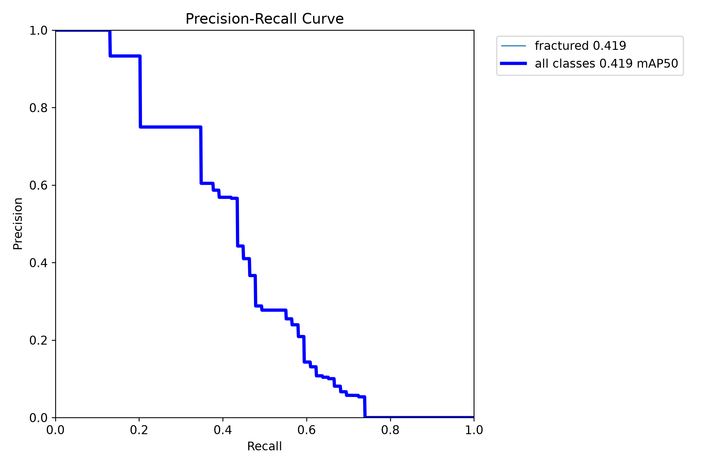

# FracAtlas results

## Summary (test set, evaluated once)

| Metric | Value |
|---|---|
| Detection model | yolov8n.pt, imgsz 640, run `fracatlas_yolov8n` |
| Detection test mAP50 | 0.419 |
| Detection test mAP50-95 | 0.169 |
| Detection test precision | 0.560 |
| Detection test recall | 0.405 |
| Classifier | yolov8m-cls.pt, imgsz 512, threshold 0.0050 (val-tuned) |
| Classification train accuracy | 0.960 |
| Classification val accuracy | 0.857 |
| Classification test accuracy | 0.872 |
| Classification test fractured recall | 0.841 |
| Classification test precision | 0.609 |
| Classification test F1 | 0.707 |
| Damaged images removed | 87 |

Classification test confusion matrix (n = 345):

| true \ predicted | fractured | non_fractured |
|---|---|---|
| fractured | 53 | 10 |
| non_fractured | 34 | 248 |

Localization recall vs false alarms on test (box level, IoU >= 0.5):

| Confidence | True boxes | Found | Missed | Box recall | Predicted boxes | Wrong boxes | Box precision | Normal images with a false box |
|---|---|---|---|---|---|---|---|---|
| 0.25 | 69 | 26 | 43 | 0.377 | 41 | 15 | 0.634 | 6 / 282 |
| 0.10 | 69 | 30 | 39 | 0.435 | 64 | 34 | 0.469 | 14 / 282 |

Classification by split (same val-tuned threshold; train = original images, no oversampled copies):

| Split | Images | Accuracy | Fractured recall | Precision | F1 |
|---|---|---|---|---|---|
| Train | 3191 | 0.960 | 1.000 | 0.817 | 0.899 |
| Val | 456 | 0.857 | 0.805 | 0.574 | 0.670 |
| Test | 345 | 0.872 | 0.841 | 0.609 | 0.707 |

> **Note:** val accuracy is slightly optimistic, because the model and the decision threshold were both chosen on the val set. **The test accuracy is the honest result**: the test set was used once, after every choice was fixed. Train accuracy is higher still, because the model learned from those images.

> **Note on the test set size (63 vs 61 fractured images):** the test set has 2 fractured images, **IMG0003375** and **IMG0003376**, beyond the 61 reported in the FracAtlas paper. The released `Utilities/Fracture Split/test.csv` lists 63 images, and the released `dataset.csv` has 719 fractured images and 924 boxes, against 717 and 922 in the paper. These 2 images (1 box each) account exactly for that difference. They are also the only 2 fractured images with a byte-identical copy in `images/Non_fractured/`. This project follows the released `test.csv` and `dataset.csv`, so both are used as fractured test images; their `Non_fractured/` copies are not used. Neither image appears in train or val, by file name or by content (MD5 check against every train and val image). The 63-image test set is the main result. **For reference, without these 2 images:** accuracy 87.2%, fractured recall 83.6% (51 / 61), precision 60.0%, F1 0.699; detection box recall at confidence 0.25: 25 / 67 = 37.3%.

## Data cleaning

Damaged images (JPEGs truncated in the original FracAtlas zip; 24 of them cut off at exactly 16,384 bytes) were removed from every split of both datasets:

| Split | Fractured | Non-fractured | Total |
|---|---|---|---|
| train | 0 | 69 | 69 |
| val | 0 | 8 | 8 |
| test | 0 | 10 | 10 |
| **all** | 0 | 87 | **87** |

Cross-split duplicates: 4 byte-identical images were found in two splits under different names; the copy in the later split was removed (train < val < test):

- `IMG0000006.jpg` (non_fractured) removed from **val**: duplicate of train:IMG0002294.jpg
- `IMG0000001.jpg` (non_fractured) removed from **val**: duplicate of train:IMG0002295.jpg
- `IMG0004341.jpg` (non_fractured) removed from **test**: duplicate of train:IMG0004314.jpg
- `IMG0000002.jpg` (non_fractured) removed from **test**: duplicate of val:IMG0002296.jpg

IMG0003298: verified fractured (dataset.csv fracture_count = 1, official test split, 1 YOLO box, in cls test/fractured). It was already labelled correctly, so no change was needed.

Final image counts after cleaning (fractured / non-fractured): train 574 / 2617, val 82 / 374, test 63 / 282.

## Model selection (VAL only)

Detection, by val mAP50 on the cleaned val set:

| Run | Val mAP50 | Val mAP50-95 | Val precision | Val recall |
|---|---|---|---|---|
| fracatlas_yolov8n (chosen) | 0.492 | 0.202 | 0.652 | 0.462 |
| detect_clean | 0.452 | 0.216 | 0.672 | 0.396 |
| detect_clean_s | 0.410 | 0.175 | 0.580 | 0.424 |

Classification: candidates tuned on val for fractured recall >= 0.85 (s, m, s+m ensemble). None reached 90% tuned val accuracy (best: m, 79.8%). The imgsz 640 / 150-epoch step was estimated at 4-6 h and skipped by the user. From the val trade-off table (`analysis/val_recall_tradeoff.md`) the user chose yolov8m-cls with the threshold tuned on val for recall >= 0.80 (the chosen row below uses that threshold; the others use 0.85).

| Run | Val acc (0.5) | Val acc (tuned) | Val recall (tuned) | Val precision (tuned) | Val F1 (tuned) | Threshold |
|---|---|---|---|---|---|---|
| fracatlas_yolov8m_cls_512 (chosen) | 0.932 | 0.857 | 0.805 | 0.574 | 0.670 | 0.0050 |
| fracatlas_yolov8s_cls_512 | 0.917 | 0.719 | 0.854 | 0.376 | 0.522 | 0.0041 |
| ensemble__fracatlas_yolov8s_cls_512__fracatlas_yolov8m_cls_512 | 0.930 | 0.741 | 0.854 | 0.398 | 0.543 | 0.0042 |

### Val accuracy vs fractured recall trade-off (deliberate threshold choice)

Because no candidate reached 90% val accuracy at 85% recall, each candidate's val accuracy was computed at thresholds giving 85%, 80% and 75% fractured recall (val only; test never used). The user chose fracatlas_yolov8m_cls_512 at 80% recall (threshold 0.0050): it gives up about 5 points of recall (4 more missed val fractures than at 85%) in exchange for about 6 points of accuracy and 31 fewer false alarms. The 75% option was closer to 90% accuracy but would miss 1 in 4 fractures.

| Run | Target recall | Threshold | Val accuracy | Val recall | Val precision | Val F1 | FN | FP |
|---|---|---|---|---|---|---|---|---|
| fracatlas_yolov8s_cls_512 | 0.85 | 0.0041 | 0.719 | 0.854 | 0.376 | 0.522 | 12 | 116 |
| fracatlas_yolov8s_cls_512 | 0.80 | 0.0065 | 0.750 | 0.805 | 0.402 | 0.537 | 16 | 98 |
| fracatlas_yolov8s_cls_512 | 0.75 | 0.0136 | 0.776 | 0.756 | 0.431 | 0.549 | 20 | 82 |
| fracatlas_yolov8m_cls_512 | 0.85 | 0.0018 | 0.798 | 0.854 | 0.467 | 0.603 | 12 | 80 |
| **fracatlas_yolov8m_cls_512 (chosen)** | 0.80 | 0.0050 | 0.857 | 0.805 | 0.574 | 0.670 | 16 | 49 |
| fracatlas_yolov8m_cls_512 | 0.75 | 0.0364 | 0.897 | 0.756 | 0.697 | 0.725 | 20 | 27 |
| ensemble__fracatlas_yolov8s_cls_512__fracatlas_yolov8m_cls_512 | 0.85 | 0.0042 | 0.741 | 0.854 | 0.398 | 0.543 | 12 | 106 |
| ensemble__fracatlas_yolov8s_cls_512__fracatlas_yolov8m_cls_512 | 0.80 | 0.0088 | 0.776 | 0.805 | 0.434 | 0.564 | 16 | 86 |
| ensemble__fracatlas_yolov8s_cls_512__fracatlas_yolov8m_cls_512 | 0.75 | 0.0572 | 0.862 | 0.756 | 0.590 | 0.663 | 20 | 43 |

## Notes

- Fractured = fracture_count > 0. Fractured images use the official FracAtlas split; non-fractured images were split randomly (seed 42) in the same ~80/11/9 ratio.
- Classifier training: fractured train images oversampled 3x (train only); the training data folder contained no test images.
- Test images were never used for training, early stopping, threshold tuning or model selection.
- Models: final_models/ (classifier threshold in classifier_threshold.json).

## Comparison with published results on FracAtlas

Published numbers are copied from each paper's own text or tables (read 2026-11-23). Anything that could not be checked against the paper's text is marked **not verified**.

| Work | Model | Task / metric scope | Test accuracy | Recall | Precision | F1 | Test mAP50 |
|---|---|---|---|---|---|---|---|
| **This project** | YOLOv8m-cls, threshold tuned on val (recall >= 0.80) | Image classification; P / R / F1 for the **fractured class** | **87.2%** | **84.1%** | **60.9%** | **0.707** | - |
| **This project** | YOLOv8n detector (imgsz 640) | Box localization, all 345 test images (69 boxes) | - | 0.405 | 0.560 | - | **0.419** |
| Abedeen et al., *FracAtlas* (Scientific Data, 2023) | YOLOv8 baselines (dataset paper) | Localization / segmentation | **not verified** | **not verified** | **not verified** | **not verified** | **not verified** |
| Ruhi, Nahar & Ashrafi (arXiv, 2024) | InceptionV3 (headline model, Table III) | Image classification; P / R / F1 averaging **not stated** | 90.48% | 90.57% | 90.57% | 90.57% | - |
| Gupta & Sharma (arXiv, 2024) | EfficientNet-B6 | Image classification; class / averaging **not stated** | 96.83% | 96.06% | 97.70% | 96.86% | - |
| Hassan et al. (arXiv, 2025, v2) | Custom CNN | Image classification; P / R / F1 for the **fractured class** | 95.96% | 88% | 94% | 0.91 | - |

Sources:
- Abedeen, I. et al. *FracAtlas: A Dataset for Fracture Classification, Localization and Segmentation of Musculoskeletal Radiographs.* Scientific Data 10, 521 (2023). https://doi.org/10.1038/s41597-023-02432-4. The full text could not be accessed (bot check / login page), so its baseline results are **not verified** and not quoted here. Other papers citing it give the dataset as 4,083 images, 717 fractured, 922 fracture instances.
- Ruhi, S. S. F., Nahar, F. & Ashrafi, A. F. *A novel approach towards the classification of Bone Fracture from Musculoskeletal Radiography images using Attention Based Transfer Learning.* arXiv:2410.14833 (2024), submitted to ICCIT 2024. https://arxiv.org/abs/2410.14833
- Gupta, S. & Sharma, D. *Bone Fracture Classification using Transfer Learning.* arXiv:2406.15958 (2024). https://arxiv.org/abs/2406.15958
- Hassan, A., Ilsa, Munib, N., Batool, A. & Noor, H. *Fracture Detection In X-rays Using Custom Convolutional Neural Network (CNN) And Transfer Learning Models.* arXiv:2509.06228 v2 (2025). https://arxiv.org/abs/2509.06228

No peer-reviewed FracAtlas **detection** (mAP50) result could be verified, so the detector has no published row to compare against. (GitHub projects and course reports with mAP50 values were found but are not peer-reviewed and were not read in full, so they are left out.)

**Why a direct comparison is not fair:**
- **Peer review:** the three classification papers are arXiv preprints, not peer-reviewed publications (Ruhi et al. was submitted to a conference; acceptance not stated).
- **Which precision / recall:** this project reports precision, recall and F1 for the **fractured class only**, the hardest and most important class. Hassan et al. do the same. Ruhi et al. give nearly identical precision, recall and F1 in every row, which suggests class-weighted averages (not stated); Gupta & Sharma do not say. Weighted averages are dominated by the non-fractured majority (about 82% of images) and are much higher than fractured-class values.
- **Threshold:** this project deliberately lowered the decision threshold to catch more fractures (val recall >= 0.80), which costs accuracy. The papers appear to use the default cut-off (not stated), which favours accuracy.
- **Split and test set:** this project uses the official FracAtlas split for fractured images, a matching random split for normal images, and removed 87 damaged images and 4 cross-split duplicates: **345 test images (63 fractured)**. Ruhi et al. use a similar split (official fractured split, non-fractured split 80 / 11.5 / 8.5%; Table I lists 347 test "instances"). Hassan et al. use a random stratified split with a test set of 2,624 images including 604 fractured, out of 717 original fractured images; the split ratio and whether augmentation came before splitting are not stated. Gupta & Sharma do not state their split or test size.
- **Possible leakage in other work:** none of the papers report checking for damaged images or for the byte-identical duplicates found here across splits, so their test sets may share images with training (not stated).
- **Small test sets:** with 63 fractured test images, one image changes recall by about 1.6 points, so differences of a few points are within noise.

## Analysis

Final models on the test set; the classifier threshold (0.0050) was fixed on val. Nothing here was tuned on test.

**Region note:** region groups come from the dataset.csv flags and **overlap**: a mixed image is also counted under every body part it is flagged with (IMG0003298 is hand + leg + mixed). The *(single)* rows keep only images with exactly one of hand / leg / hip / shoulder and mixed = 0, so those rows do not overlap.

### Classification (classifier only, per image)

| true \ predicted | fractured | non_fractured |
|---|---|---|
| fractured | 53 | 10 |
| non_fractured | 34 | 248 |

| Group | Images | Fractured | Accuracy | Recall | Precision | F1 | TP / FN / FP / TN |
|---|---|---|---|---|---|---|---|
| **all** | 345 | 63 | 0.872 | 0.841 | 0.609 | 0.707 | 53 / 10 / 34 / 248 |
| hand | 133 | 36 | 0.827 | 0.833 | 0.638 | 0.723 | 30 / 6 / 17 / 80 |
| leg | 179 | 26 | 0.883 | 0.846 | 0.564 | 0.677 | 22 / 4 / 17 / 136 |
| hip | 28 | 2 | 0.857 | 1.000 | 0.333 | 0.500 | 2 / 0 / 4 / 22 |
| shoulder | 43 | 2 | 0.907 | 0.000 | 0.000 | 0.000 | 0 / 2 / 2 / 39 |
| mixed | 37 | 3 | 0.811 | 0.333 | 0.167 | 0.222 | 1 / 2 / 5 / 29 |
| hand (single) | 103 | 33 | 0.816 | 0.879 | 0.659 | 0.753 | 29 / 4 / 15 / 55 |
| leg (single) | 171 | 25 | 0.895 | 0.840 | 0.600 | 0.700 | 21 / 4 / 14 / 132 |
| hip (single) | 20 | 2 | 1.000 | 1.000 | 1.000 | 1.000 | 2 / 0 / 0 / 18 |
| shoulder (single) | 14 | 0 | 1.000 | - | - | - | 0 / 0 / 0 / 14 |

'-' = undefined (no fractured images or no positive predictions in that group). Groups with only a few fractured images give unstable numbers.

Errors: `errors/classification/missed_fractures/` (10 most confidently missed, lowest P(fractured)) and `errors/classification/false_alarms/` (10 most confident, highest P(fractured)).

| Group | n | Hardware | Mixed | Median image (MP) | Views | Regions |
|---|---|---|---|---|---|---|
| Missed fractures (FN) | 10 | 0.100 | 0.200 | 0.169 | frontal 4, oblique 4, frontal+lateral 1, lateral 1 | hand 6, leg 4, shoulder 2, mixed 2 |
| Caught fractures (TP) | 53 | 0.057 | 0.019 | 0.169 | frontal 29, lateral 24 | hand 30, leg 22, hip 2, mixed 1 |
| False alarms (FP) | 34 | 0.000 | 0.147 | 0.169 | frontal 24, lateral 7, oblique 2, frontal+lateral 1 | hand 17, leg 17, hip 4, shoulder 2, mixed 5 |
| Correct normals (TN) | 248 | 0.000 | 0.117 | 0.169 | frontal 154, lateral 61, frontal+lateral 17, oblique 16 | hand 80, leg 136, hip 22, shoulder 39, mixed 29 |

### Localization (detector only, per box, IoU >= 0.5)

Test set: **69 true fracture boxes** in 63 fractured images (the 924 boxes in FracAtlas are spread over all splits). At conf >= 0.25: **26 found, 43 missed** (box recall 0.377); 41 predicted boxes, of which 15 wrong (6 on non-fractured images, 9 on fractured images but in the wrong place).

mAP50, precision and recall are Ultralytics values (P/R at the confidence with best F1); Found / Missed / Wrong are the box counts at conf >= 0.25.

| Group | Images | Fractured images | mAP50 | Precision | Recall | True boxes | Found | Missed | Wrong boxes |
|---|---|---|---|---|---|---|---|---|---|
| **all** | 345 | 63 | 0.419 | 0.560 | 0.405 | 69 | 26 | 43 | 15 |
| hand | 133 | 36 | 0.402 | 0.667 | 0.375 | 40 | 15 | 25 | 11 |
| leg | 179 | 26 | 0.474 | 0.641 | 0.481 | 27 | 11 | 16 | 4 |
| hip | 28 | 2 | 0.372 | 0.026 | 0.667 | 3 | 0 | 3 | 0 |
| shoulder | 43 | 2 | 0.000 | 0.000 | 0.000 | 2 | 0 | 2 | 0 |
| mixed | 37 | 3 | 0.000 | 0.000 | 0.000 | 3 | 0 | 3 | 0 |
| hand (single) | 103 | 33 | 0.441 | 0.667 | 0.405 | 37 | 15 | 22 | 11 |
| leg (single) | 171 | 25 | 0.491 | 0.643 | 0.500 | 26 | 11 | 15 | 4 |
| hip (single) | 20 | 2 | 0.395 | 0.041 | 0.667 | 3 | 0 | 3 | 0 |
| shoulder (single) | 14 | 0 | - | - | - | 0 | 0 | 0 | 0 |

Box size: recall on boxes smaller than the median (0.0031 of image area) = 0.206, on larger boxes = 0.543.

Precision-recall curve (test, all images): `analysis/detection_PR_curve_test.png`

Errors: `errors/localization/missed_boxes/` (10 largest missed true boxes) and `errors/localization/wrong_boxes/` (10 most confident wrong boxes). Green = true box, red = predicted box with confidence, yellow outline = the box the file is about.

| Group | n | Median box area | Hardware | Mixed | Views |
|---|---|---|---|---|---|
| Missed true boxes | 43 | 0.0024 | 0.093 | 0.070 | frontal 23, lateral 16, oblique 3, frontal+lateral 1 |
| Found true boxes | 26 | 0.0040 | 0.038 | 0.000 | frontal 15, lateral 10, oblique 1 |

### Detection models on val

| Run | Val mAP50 | Val mAP50-95 | Val precision | Val recall |
|---|---|---|---|---|
| fracatlas_yolov8n (chosen) | 0.492 | 0.202 | 0.652 | 0.462 |
| detect_clean | 0.452 | 0.216 | 0.672 | 0.396 |
| detect_clean_s | 0.410 | 0.175 | 0.580 | 0.424 |

`fracatlas_yolov8n` was chosen because it has the higher val mAP50 on the cleaned val set (rule fixed before testing). Only this model was evaluated on test.

### Summary

- **Classification works reasonably well:** on the 345 unseen test images the classifier is right 87.2% of the time and catches 53 of 63 fractures (84.1% recall), close to its val result (85.7% accuracy, 80.5% recall), so the val-chosen threshold carried over to new images. The price of the low threshold is false alarms: about 2 in 5 "fractured" predictions are wrong (34 of 87).
- **Missed fractures are concentrated in harder images:** shoulder and mixed-region X-rays, oblique views and images with surgical hardware make up a much larger share of the misses than of the fractures that were caught, and these groups have very few training examples.
- **Localization is much harder than classification:** the detector reaches a test mAP50 of 0.419 and, at confidence 0.25, finds only 26 of the 69 fracture boxes; lowering the confidence to 0.10 finds 30 boxes but more than doubles the wrong boxes (15 to 34). Small fractures are the main problem (box recall 0.21 on small boxes vs 0.54 on larger ones).
- **Bigger or retrained was not better for localization:** on the cleaned val set the original YOLOv8n (0.492 mAP50) beat the retrained YOLOv8n (0.452) and the larger YOLOv8s (0.410), so the original model was used. It was trained before cleaning (with 69 damaged non-fractured train images and on an uncleaned val set for its best epoch); the test set was cleaned and contains no duplicates of its training images.
- **Overall:** the classifier is usable as a screening aid that flags most fractures for a second look, but the boxes should be read as rough hints rather than precise locations; this is a research project, not a medical device.
